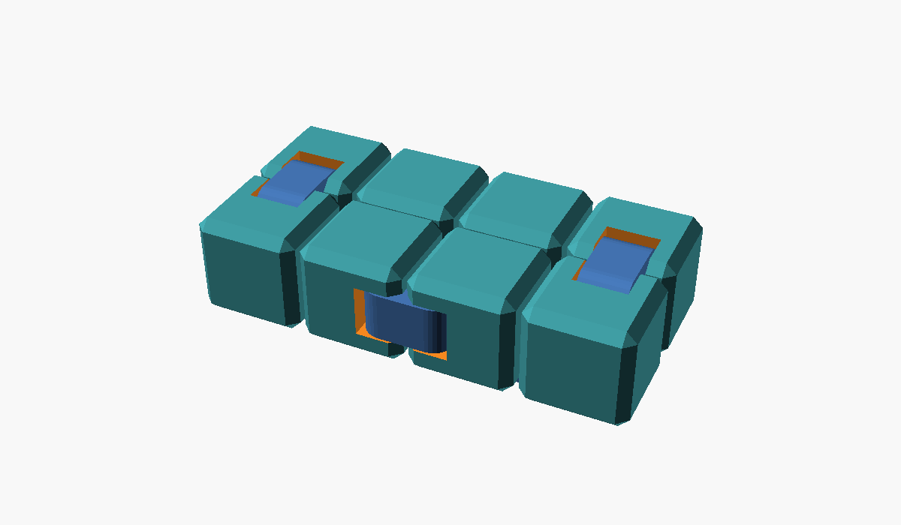
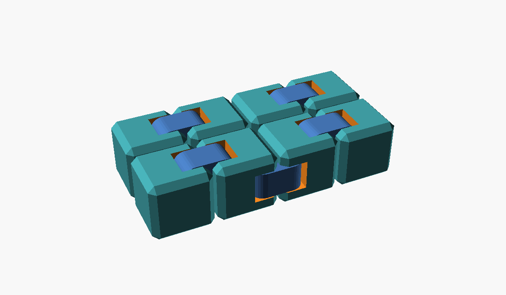
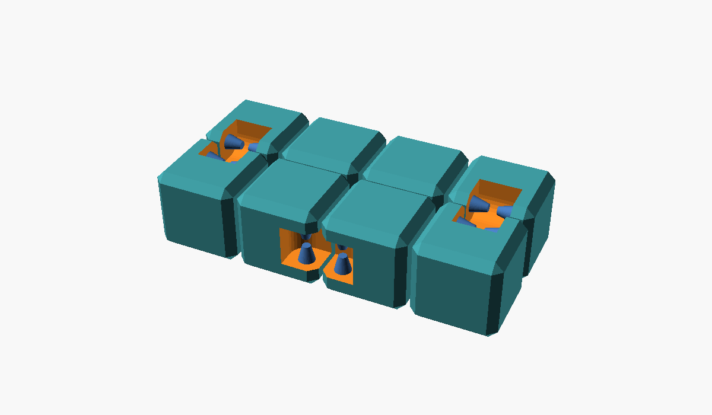

# infinity-cube-scad

A print-in-place infinity cube, designed in OpenSCAD. Eight cubes in a 4 × 2
block, joined by eight hinges, fold through each other endlessly. It prints in
one piece, with no assembly: each hinge is a link sunk into a channel across
two cubes, turning on cone pins that stand out from the channel's ends.

## Use it

Open `infinity-cube.scad` in [OpenSCAD](https://openscad.org), set the size,
and export an STL.

| Parameter | Default | Description |
| --- | --- | --- |
| `size` | 20 | Edge of each cube, in mm. The whole cube is `4 × size + 3` by `2 × size + 1` by `size`. |
| `spacing` | 1 | Gap between neighbouring cubes. |
| `chamfer` | 2 | Chamfer on the cubes' edges; must be less than the hinge radius. |
| `hinge_radius` | 0 | Hinge radius. 0 uses `size / 5`, so the hinges scale with the cube. |
| `clearance` | 0.4 | Gap between each link and its channel. |
| `pin_clearance` | 0.5 | Radial gap between each pin and its socket. |
| `supports` | true | Thin break-away supports under the links that print sideways or upside down. |
| `show_links` | true | Leave the links out to look at the channels and pins. |
| `part` | `"cube"` | `"none"` renders nothing, for including the file. |

The clearances stay fixed as the cube scales, so the fit doesn't change with
size. The checks cover sizes from 12 to 30 mm.

### Printing

Print it as it sits, bottom face down. The four bottom links print flat. The
two side links and two top links print sideways or upside down, so each has a
0.2 mm support that ties it to its cubes. Break those after printing, then
work the cube a few times to free the hinges.

To tune `clearance` and `pin_clearance` for a printer first, print
[`examples/test_hinge.scad`](examples/test_hinge.scad): two cubes and one hinge, at
the same size and clearances.

## Checks

`just test` takes about 3 s on OpenSCAD 2026.10.15. At sizes 12, 14, 20 and
30 mm it checks:

- the cube renders at the expected size as 8 pieces: the 4 bottom links,
  and 4 groups of cubes and links tied together by the supports. Without
  supports it's 16: every cube and link separate;
- every link clears its channel and the pins, and no two links touch;
- all 32 pins reach into their links, so no link can fall out;
- a hinge folds freely to 90°, bottom face to bottom face, and is blocked
  past it;
- folded, the hinge's two cubes don't overlap.

`just images` renders the pictures above.

## Licence

MIT; see [LICENSE](LICENSE).
